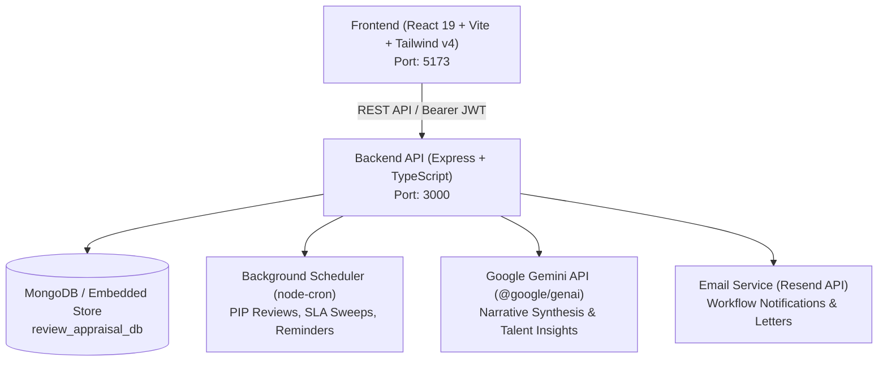

# 🏢 QReview — Enterprise Performance Management & Annual Appraisal System

> The app is branded **MintReview** in the browser (page title, logo); `QReview` is the repository name.

A modern, full-stack enterprise performance management and annual appraisal platform built with **React 19**, **Express.js**, **TypeScript**, and **MongoDB**. Supports multi-cohort review cycles, 4-quarter rolling performance appraisals, automated Performance Improvement Plans (PIP) with a 2-step fast-flow, 9-box talent matrix calibration, bell-curve budget normalization, and digital appraisal letter workflows.

---

## 📑 Table of Contents

- [System Architecture](#-system-architecture)
- [Repository Structure](#-repository-structure)
- [Core Features & Modules](#-core-features--modules)
  - [Role-Based Access Control (RBAC)](#1-role-based-access-control-rbac)
  - [Quarterly Review Lifecycle](#2-quarterly-review-lifecycle)
  - [Automated Performance Improvement Plan (PIP) Engine](#3-automated-performance-improvement-plan-pip-engine)
  - [Annual Appraisal & Salary Increments](#4-annual-appraisal--salary-increments)
  - [Executive & Department Dashboards](#5-executive--department-dashboards)
  - [AI Performance Narrative Synthesis](#6-ai-performance-narrative-synthesis)
  - [Sales Champions & Incentive Scheme Engine](#7-sales-champions--incentive-scheme-engine)
  - [Interactive Notifications Center & Alert Feed](#8-interactive-notifications-center--alert-feed)
  - [HTML5 Clean Routing Architecture](#9-html5-clean-routing-architecture)
  - [Production CORS & Multi-Cloud Deployment Gateway](#10-production-cors--multi-cloud-deployment-gateway)
- [Prerequisites](#-prerequisites)
- [Quick Start Guide](#-quick-start-guide)
  - [1. Backend Setup](#1-backend-setup)
  - [2. Frontend Setup](#2-frontend-setup)
- [Environment Variables](#-environment-variables)
- [Available Scripts](#-available-scripts)
- [API Route Catalog](#-api-route-catalog)
- [Design System & Aesthetics](#-design-system--aesthetics)

---

## 🏗️ System Architecture



- **Frontend:** React 19, Vite 6, Tailwind CSS v4, Lucide Icons, Recharts, Framer Motion, jsPDF & html2canvas.
- **Backend:** Node.js, Express 4, TypeScript 5.8, MongoDB Driver 7.6 (with zero-dependency fallback store), Vitest 3.
- **AI Engine:** Google Gemini (`@google/genai` on `gemini-3.8-flash`).
- **Security:** JWT authentication, Bcrypt password hashing, route-level RBAC middleware, strict request rate-limiting, and ISO-compliant audit logging.

---

## 📂 Repository Structure

```text
Review_system/
├── Qreview_backend/                 # Node.js + Express + TypeScript Backend
│   ├── server.ts                    # Server bootstrap, CORS & rate limit configuration
│   ├── server/
│   │   ├── db.ts                    # Database abstraction (MongoDB + persistence layer)
│   │   ├── auth.ts                  # JWT token verify, RBAC checks & audit log logger
│   │   ├── validation.ts            # Zod request-body schemas & validateBody middleware
│   │   ├── syncHelpers.ts           # Master data sync & cascade helpers
│   │   ├── jobs/
│   │   │   └── scheduler.ts         # Automated cron jobs (daily PIP review engine, reminders, SLA sweeps)
│   │   ├── services/
│   │   │   ├── appraisalScoring.ts  # 4-quarter rolling averages & bell curve matrix
│   │   │   ├── departmentBudget.ts  # Department increment budget snapshots
│   │   │   ├── periodLifecycle.ts   # Review period auto-activation & rollover
│   │   │   ├── reviewEligibility.ts # Who is eligible for a review in a period
│   │   │   ├── pipReviewService.ts  # 7-day PIP review generator & overlap protection
│   │   │   ├── pipService.ts        # PIP milestone tracking & status transitions
│   │   │   ├── workflowService.ts   # Review state machine transitions
│   │   │   ├── reviewReturnService.ts # HOD/HR return workflows & SLA timeouts
│   │   │   ├── dashboardInsights.ts # Analytics rollup & reviewer backlog computation
│   │   │   ├── emailService.ts      # Resend email delivery
│   │   │   └── emailTemplates.ts    # Workflow email HTML templates
│   │   └── routes/
│   │       ├── authRoutes.ts        # Login, refresh, logout, change password, demo role switching
│   │       ├── reviewRoutes.ts      # Quarterly scoring, self-assessments, returns, 2-step PIP fast flow
│   │       ├── pipRoutes.ts         # PIP CRUD, check-ins, outcomes, review triggers
│   │       ├── appraisalRoutes.ts   # Cohort rollups, increments, digital letter release
│   │       ├── dashboardRoutes.ts   # Role-tailored dashboard summary & reviewer reminders
│   │       ├── managementRoutes.ts  # Executive-level workforce trends & risk analysis
│   │       ├── kraRoutes.ts         # KRA library & scorecard templates
│   │       ├── mastersRoutes.ts     # Employees, departments, designations, locations, cycles, notifications
│   │       ├── essRoutes.ts         # Employee self-service overview
│   │       ├── reportRoutes.ts      # Tabular report generators
│   │       ├── bulkRoutes.ts        # CSV/Excel import templates, validation, import & export
│   │       ├── auditRoutes.ts       # Compliance & audit trail explorer
│   │       ├── emailRoutes.ts       # Email logs, health & test send
│   │       ├── salesChampsRoutes.ts # Sales targets, incentive schemes, slabs & report locks
│   │       └── aiAndFeedbackRoutes.ts # Gemini AI narratives, talent insights & talent records
│   ├── src/types/                   # Shared TypeScript domain contracts
│   ├── package.json
│   └── tsconfig.json
│
├── Qreview_frontend/                # React 19 + Vite Frontend Application
│   ├── src/
│   │   ├── App.tsx                  # Root application router and shell
│   │   ├── config/
│   │   │   └── navigation.ts        # Sidebar items, groups & per-role visibility
│   │   ├── hooks/
│   │   │   ├── useUrlHashView.ts    # HTML5 clean routing hook (path & popstate sync)
│   │   │   ├── useModalAnimation.ts # Modal enter/exit animation state
│   │   │   ├── useMasterData.ts     # Cached departments, designations & employees
│   │   │   └── useIsMobile.ts       # Mobile breakpoint detection
│   │   ├── components/
│   │   │   ├── QuarterlyReviewView.tsx      # Reviews table, KRA scoring modals, PIP filters
│   │   │   ├── AppraisalManagementView.tsx  # Appraisal matrix, increments, letter signing
│   │   │   ├── PerformanceImprovementPlansView.tsx # PIP tracking, milestones, check-ins
│   │   │   ├── ManagementDashboardView.tsx  # C-suite analytics, department comparisons
│   │   │   ├── SalesChampsView.tsx          # Sales champions leaderboard, metrics & attainment
│   │   │   ├── SalesChampsReportModal.tsx   # Detailed incentive scheme scorecard & export
│   │   │   ├── NotificationsCenterView.tsx  # Activity feed with Show More/Hide controls
│   │   │   ├── EmployeeDirectory.tsx        # Employee profiles & organizational hierarchy
│   │   │   ├── ReviewScoringModal.tsx       # 2-step fast-flow and 4-step governance evaluation
│   │   │   ├── reviews/ReviewScoringModal/  # Scoring modal parts: Step1–Step4 sections, returns, audit trail
│   │   │   ├── PipDetailModal.tsx           # PIP plan viewer & check-in logger
│   │   │   ├── AppraisalLetterModal.tsx     # Letter release, digital signing & PDF download
│   │   │   ├── ReportsCenterView.tsx        # Report catalogue & charts (see reports/)
│   │   │   ├── ui/                          # Shared primitives: Button, StatusBadge, PageHeader, Sidebar, SegmentedControl, formStyles
│   │   │   └── dashboard/
│   │   │       ├── DashboardView.tsx        # Picks the dashboard for the signed-in role
│   │   │       ├── RoleDashboards.tsx       # Role-specific dashboard layouts, TeamPipHighlightCard
│   │   │       ├── DashboardKit.tsx         # Reusable cards & stats, PeopleCard with PIP alerts
│   │   │       └── InsightCards.tsx         # Calibration, reviewer backlog & coverage cards
│   │   ├── context/                         # AuthContext, ToastContext, ThemeContext, NotificationsContext
│   │   ├── services/
│   │   │   └── api.ts                       # Typed HTTP client with token refresh & error handling
│   │   ├── utils/
│   │   │   ├── salesChampsExport.ts         # Client-side PDF & Excel export generator for champions
│   │   │   ├── letterExport.ts              # Appraisal letter PDF export
│   │   │   ├── reviewLetterExport.ts        # Review letter PDF export
│   │   │   ├── pipLetterExport.ts           # PIP letter PDF export
│   │   │   └── auditExport.ts               # Audit trail export
│   │   └── types/                           # Frontend domain models & view state types
│   ├── package.json
│   ├── vite.config.ts
│   └── tsconfig.json
│
├── PRODUCT.md                       # Product context (users, purpose, principles)
├── DESIGN.md                        # Visual design system (tokens, components, rules)
└── README.md                        # Master repository documentation
```

---

## 🌟 Core Features & Modules

### 1. Role-Based Access Control (RBAC)
The system supports six distinct enterprise roles with strict server-side authorization:
- **`EMPLOYEE`**: Self-service dashboard, self-assessments, view assigned KRAs, acknowledge appraisals, view PIP milestones.
- **`MANAGER` / `REPORTING_MANAGER`**: Direct report evaluations, increment proposals, PIP creation and weekly 2-step check-in reviews.
- **`HOD` (Head of Department)**: Department-wide calibration, scorecard approvals, reviewing returned manager scores, department PIP oversight.
- **`HR` / `SUPER_ADMIN`**: Full administrative governance, review period creation, annual appraisal finalization, letter release, and audit compliance.
- **`MANAGEMENT`**: Executive dashboard, bell-curve compliance, workforce attrition risk analysis, and department benchmarking.
- **Persona Switcher (Dev Mode)**: Fast switching between test users to validate multi-tier workflow handoffs. Shown in development builds, or in production only when `VITE_ENABLE_DEMO_PERSONAS=true`.

---

### 2. Quarterly Review Lifecycle
Evaluations run on structured quarterly review periods (Q1 to Q4):
1. **Self-Assessment (`EMPLOYEE`)**: Employees score their assigned KRAs, document deliverables, and submit.
2. **Manager Scoring (`MANAGER`)**: Reporting managers score performance, add qualitative remarks, and submit.
3. **HOD Calibration (`HOD`)**: HOD verifies manager scores, adjusts if necessary, or returns individual KRAs with feedback.
4. **HR Final Approval (`HR`)**: HR signs off to close the review and lock the final score.
- **Return with SLA Sweep**: Reviews returned for revision have configurable SLA timeouts. If a reviewer misses the SLA, automated reminders trigger or auto-escalate.

---

### 3. Automated Performance Improvement Plan (PIP) Engine
Comprehensive lifecycle management for employees requiring structured performance support:

- **Automated Review Generation (`pipReviewService.ts`)**:
  - A daily background job (01:15) generates any weekly review that has come due (every 7 days per PIP); it can also be triggered manually.
  - Converts assigned PIP goals directly into immutable `kraSnapshot` scorecard items with balanced weights totalling 100%.
  - Overlap protection ensures a new weekly review is never stacked on top of an uncompleted one.
- **2-Step Fast Flow (Weekly Reviews)**:
  - **Step 1**: Employee completes self-assessment on their PIP goals.
  - **Step 2**: Manager evaluates and submits scores $\rightarrow$ The review immediately transitions to `CLOSED`.
  - Bypasses HOD and HR sign-offs to eliminate recurring weekly administrative fatigue.
  - **Auto Check-in Sync**: Submitting the review automatically appends a completed check-in record directly into `performanceImprovementPlans.checkIns` with goal ratings and manager feedback.
- **PIP Final Review**:
  - Triggered at the end of the PIP duration (`now >= pip.endDate`).
  - Follows the complete 4-step governance flow (**Employee** $\rightarrow$ **Manager** $\rightarrow$ **HOD** $\rightarrow$ **HR**) to ensure formal closure and decision alignment.
- **Appraisal Isolation Safeguard**:
  - Weekly PIP scores and final reviews are isolated from annual appraisal calculations, ensuring rolling 4-quarter averages and salary increment brackets remain strictly uncorrupted.
- **Manager & HOD Dashboard Highlights**:
  - **`TeamPipHighlightCard`**: Calm amber banner at the top of Manager and HOD dashboards displaying active plans, elapsed time progress bar, days left, and quick action links.
  - **`PeopleCard` Highlighting**: Team members on PIP display an amber **`On PIP`** badge, subtle amber background tint, left border accent, and are sorted to the top of the list.

---

### 4. Annual Appraisal & Salary Increments
- **Rolling 4-Quarter Rollup**: Averages the employee's last four manager-evaluated quarterly review scores.
- **Performance Rating Matrix**:
  - **Outstanding** ($\ge 4.5$ score): Recommended 15% – 20% increment.
  - **Exceeds Expectations** ($\ge 3.8$ score): Recommended 10% – 14% increment.
  - **Meets Expectations** ($\ge 2.8$ score): Recommended 5% – 9% increment.
  - **Needs Improvement** ($< 2.8$ score): Recommended 0% – 4% increment.
- **Bell Curve & Budget Pool**:
  - Normalizes ratings against organizational targets (10% Outstanding, 25% Exceeds, 45% Meets, 20% Needs Improvement).
  - Department budget tracker shows proposed increments vs allocated department payroll budget.
- **Digital Appraisal Letters**:
  - Generates branded increment letters with current CTC, revised CTC, increment percentage, and effective date.
  - Supports digital signatures, employee acknowledgment, and client-side PDF export.

---

### 5. Executive & Department Dashboards
- **Tailored Role Dashboards**: Separate views customized for Employee, Manager, HOD, HR, and Admin.
- **Executive Analytics (`ManagementDashboardView.tsx`)**:
  - Real-time department completion rates and average score heatmaps.
  - Top performers and employees requiring attention.
  - Workforce attrition risk indicators and KRA template coverage rates.

---

### 6. AI Performance Narrative Synthesis
- Integrated with Google Gemini (`gemini-3.8-flash`) via `@google/genai`; disabled when `GEMINI_API_KEY` is not set.
- Synthesizes quarterly scores, employee comments, and manager feedback into clear, objective performance summaries and constructive growth recommendations.

---

### 7. Sales Champions & Incentive Scheme Engine
Dedicated sales performance tracking, milestone recognition, and incentive compensation governance module:
- **Annual & Quarterly Sales Targets**: Tracks Gross Margin 2 (`gm2TargetCr`) targets and achievements across financial years.
- **Incentive Slabs & Attainment Tiers**: Tiered reward matrices (e.g. 80%–99%, 100%–119%, 120%+) with calculated payout percentages and Mint Value recognition criteria.
- **Governance Lifecycle (`DRAFT` $\rightarrow$ `FINAL` $\rightarrow$ `LOCKED`)**: HR or Super Admin drafts and finalizes a report; only a Super Admin can lock it. Employees get read-only access once it is locked.
- **Client-Side Multi-Format Export**: Generates professional branded PDF achievement certificates via `jspdf`/`html2canvas` and spreadsheet reports via SheetJS `xlsx` (`salesChampsExport.ts`).

---

### 8. Interactive Notifications Center & Alert Feed
- **Interactive Activity Feed (`NotificationsCenterView.tsx`)**: Centralized inbox tracking appraisal releases, review returns, SLA deadlines, PIP check-ins, and system notices.
- **"Show More" / "Hide" Expandable Details**: Dynamic toggle controls allowing users to expand verbose feedback, goal ratings, and audit remarks without cluttering the list view.
- **Unread Count & Audio/Visual Bell**: Instant unread badge indicators with one-click "Mark All as Read" and category filtering (Reviews, Appraisals, PIP, System).

---

### 9. HTML5 Clean Routing Architecture
- **Path-Based Navigation**: Modern URL schema (`/dashboard`, `/management`, `/reviews`, `/appraisals`, `/calibration`, `/sales_champs`, `/reports`, `/employees`, `/hierarchy`, `/pip`, `/kras`, `/ai_performance`, `/bulk`, `/audit`, `/notifications`) powered by the HTML5 History API (`pushState`, `replaceState`, `popstate`), completely eliminating hash fragment routing (`#`).
- **Backward Compatibility**: Automatically catches legacy bookmark hashes (`/#dashboard`) and smoothly elevates them to clean URLs.
- **Dynamic Role-Based Landing**: Automatically redirects root visits (`/`) to the authenticated user's designated workspace home view.
- **SPA Fallback Ready**: Configured for Vite development and seamless production deployment on Express and Nginx (`try_files $uri $uri/ /index.html;`).

---

### 10. Production CORS & Multi-Cloud Deployment Gateway
- **Multi-Environment Origin Authorization**: Dynamic CORS middleware in `server.ts` safely validating production domains, local development ports, and wildcard subdomains.
- **Vercel Preview Auto-Matching**: Built-in pattern recognition that instantly accommodates dynamic Vercel PR and preview deployment URLs (e.g., `mint-review-system*.vercel.app` and `*chirag-tank1971s-projects.vercel.app`) without requiring manual environment variable reconfiguration on every commit.
- **Strict Preflight Handling**: Explicit `OPTIONS` preflight middleware routing guaranteeing fast 204 No Content responses across all API endpoints.

---

## 💻 Prerequisites

Ensure you have the following installed:
- **Node.js**: `v18.x`, `v20.x`, or `v22.x` (LTS recommended)
- **npm**: `v9.x` or `v10.x`
- **MongoDB** *(Optional)*: MongoDB Compass or Atlas connection. If omitted, the backend automatically runs its built-in zero-dependency persistent JSON store (`.local_database_store.json`).

---

## 🚀 Quick Start Guide

### 1. Backend Setup

```bash
# Navigate to the backend directory
cd Qreview_backend

# Install dependencies
npm install

# Configure environment variables
# Copy or edit .env (see Environment Variables section below)

# Run backend development server
npm run dev
```

The backend API will start on:
👉 **`http://localhost:3000`**

To verify:
```bash
curl http://localhost:3000/api/health
```

---

### 2. Frontend Setup

In a new terminal window:

```bash
# Navigate to the frontend directory
cd Qreview_frontend

# Install dependencies
npm install

# Run frontend development server
npm run dev
```

The frontend client will start on:
👉 **`http://localhost:5173`** (or next available port)

Open your browser and navigate to `http://localhost:5173` to access the application.

---

## ⚙️ Environment Variables

### Backend (`Qreview_backend/.env`)

```env
# Server Port (Default: 3000)
PORT=3000

# Node Environment ('development' | 'production')
NODE_ENV=development

# JWT secret for access tokens. Required in production (min 32 chars) or the server refuses to start;
# development falls back to a built-in dev-only secret.
JWT_SECRET=replace_with_a_random_string_of_at_least_32_characters

# Optional: separate secret for refresh tokens (min 32 chars). Derived from JWT_SECRET if unset.
JWT_REFRESH_SECRET=

# Allowed CORS Origins (comma-separated; supports * and *.domain.com patterns).
# Ignored outside production, where every origin is allowed.
ALLOWED_ORIGINS=http://localhost:5173,https://qreview-frontend.vercel.app

# Public URL of the frontend, used for links inside emails
APP_URL=http://localhost:5173

# Optional: keep console.log/info/warn output in production (silenced by default)
ENABLE_PROD_LOGS=false

# Optional: MongoDB URI (falls back to local embedded store if not reachable)
MONGODB_URI=mongodb+srv://<username>:<password>@cluster0.mongodb.net/review_appraisal_db?retryWrites=true&w=majority

# Optional: Google Gemini API Key for AI synthesis features
GEMINI_API_KEY=your_gemini_api_key_here

# Optional: Resend API Key for automated email notifications (emails are skipped when unset)
RESEND_API_KEY=your_resend_api_key_here

# Optional: sender address for emails (default: "Appraisal System <onboarding@resend.dev>")
RESEND_FROM=
```

### Frontend (`Qreview_frontend/.env`)

```env
# Optional: Backend API Base URL, without /api (defaults to http://localhost:3000 on localhost, relative /api in production)
VITE_API_BASE_URL=http://localhost:3000

# Optional: show the demo persona switcher in production builds (always shown in dev)
VITE_ENABLE_DEMO_PERSONAS=false
```

---

## 📜 Available Scripts

### Backend (`Qreview_backend`)

| Command | Description |
| :--- | :--- |
| `npm run dev` | Starts backend development server with hot-reloading via `tsx watch` |
| `npm run build` | Bundles backend into single-file CommonJS distribution using `esbuild` |
| `npm start` | Runs the compiled production bundle (`dist/server.cjs`) |
| `npm run typecheck` | Validates TypeScript types across the backend codebase (`tsc --noEmit`) |
| `npm run lint` | Runs ESLint checks on backend files |

### Frontend (`Qreview_frontend`)

| Command | Description |
| :--- | :--- |
| `npm run dev` | Starts Vite development server with Fast Refresh |
| `npm run build` | Compiles and optimizes client bundle for production (`dist/`) |
| `npm run preview` | Serves the production build locally for verification |
| `npm run typecheck` | Validates TypeScript types across all React components (`tsc --noEmit`) |
| `npm run lint` | Runs ESLint checks on frontend files |

---

## 📡 API Route Catalog

| Route Prefix | Category | Description & Capabilities |
| :--- | :--- | :--- |
| `GET /api/health` | System | Unauthenticated health check |
| `POST /api/auth/login` | Authentication | Authenticates credentials and returns access + refresh tokens (rate-limited: 10 failed attempts / 15 min) |
| `POST /api/auth/refresh` | Authentication | Exchanges a refresh token for a new access token |
| `GET /api/auth/me` | Authentication | Retrieves authenticated user profile, permissions, and active role |
| `PUT /api/auth/change-password` | Authentication | Changes password (also used for forced first-login change) |
| `POST /api/auth/switch-role` | Auth (Dev Mode) | Rapid persona switching for testing workflows across roles |
| `GET /api/dashboard/summary` | Dashboard | Returns aggregated role-specific dashboard data, tasks, and alerts |
| `GET /api/reviews` | Reviews | Lists reviews filtered by period, department, status, or review type |
| `PUT /api/reviews/:id/self-assess` | Reviews | Saves the employee's self-assessment |
| `PUT /api/reviews/:id/score` | Reviews | Saves manager/HOD KRA scores |
| `POST /api/reviews/:id/submit` | Reviews | Submits the current step; closes weekly PIP reviews after the manager step (**2-step fast-flow**) |
| `POST /api/reviews/:id/return` | Reviews | Returns individual KRAs for revision with remarks and SLA deadline |
| `POST /api/reviews/:id/hod-approve` | Reviews | HOD approves the calibrated review |
| `POST /api/reviews/:id/complete` | Reviews | HR final sign-off; closes the review |
| `GET /api/pips` | PIP Management | Lists Performance Improvement Plans with status and check-ins |
| `POST /api/pips` | PIP Management | Creates a new PIP with target goals and review cadence (HR / Super Admin) |
| `POST /api/pips/:id/generate-review` | PIP Management | Generates next due 7-day weekly review or PIP final review |
| `POST /api/pips/:id/checkins` | PIP Management | Manually logs milestone check-in and goal ratings on a PIP |
| `POST /api/pips/:id/outcome` | PIP Management | Records the PIP outcome (succeeded / failed / extended) |
| `GET /api/appraisals` | Appraisals | Lists employee appraisals with rolling 4-quarter scores |
| `PUT /api/appraisals/:id/manager-recommend` | Appraisals | Submits manager salary increment recommendation |
| `PUT /api/appraisals/:id/hod-calibrate` | Appraisals | Submits HOD calibrated final rating and increment |
| `PUT /api/appraisals/:id/hr-approve` | Appraisals | HR final approval |
| `PUT /api/appraisals/:id/lock` | Appraisals | Locks the appraisal and releases the digital letter (Super Admin) |
| `PUT /api/appraisals/:id/acknowledge` | Appraisals | Employee acknowledges the appraisal letter |
| `GET /api/kras` / `GET /api/kra-templates` | KRAs | KRA library and organization/department scorecard templates |
| `GET /api/employees` | Master Data | Employee directory (also `/departments`, `/designations`, `/locations`, `/cycles`, `/review-periods`) |
| `GET /api/dashboard/management` | Executive | C-level department KPIs, workforce risk, and trends (more under `/api/management/*`) |
| `GET /api/reports/*` | Reports | Quarterly status, pending/overdue, department performance, rating trend, return analytics, and more |
| `POST /api/gemini/generate-review-narrative` | AI Synthesis | Generates a Gemini AI performance narrative |
| `POST /api/gemini/talent-insights-summary` | AI Synthesis | Generates a Gemini talent insights summary |
| `GET /api/audit/logs` | Compliance | Queries the audit trail (also `/summary`, `/timeline/:employeeId`, `/export`) |
| `GET /api/bulk/templates/:type` | Bulk Data | Downloads an import template (also `/validate`, `/import`, `/export`, `/history`) |
| `GET /api/sales-champs` | Sales Champions | Lists sales champion incentive reports with filter by FY and status |
| `GET /api/sales-champs/employee/:employeeId` | Sales Champions | Retrieves locked incentive report for an employee |
| `POST /api/sales-champs` | Sales Champions | Creates new sales target and slab scorecard in DRAFT status |
| `PUT /api/sales-champs/:id` | Sales Champions | Updates target values, incentive slabs, and recognition rules |
| `POST /api/sales-champs/:id/finalize` | Sales Champions | Moves the report from DRAFT to FINAL |
| `POST /api/sales-champs/:id/lock` | Sales Champions | Locks and officially publishes the incentive report (Super Admin) |
| `DELETE /api/sales-champs/:id` | Sales Champions | Deletes a sales champ report (Super Admin) |
| `GET /api/notifications` | Notifications | Retrieves the user's notification activity feed |
| `PUT /api/notifications/:id/read` | Notifications | Marks specific notification as read |
| `PUT /api/notifications/read-all` | Notifications | Marks all user notifications as read |

---

## 🎨 Design System & Aesthetics

The full visual system lives in [DESIGN.md](DESIGN.md); this is a summary.

- **Color Palette:**
  - Neutral Base: Slate tones (`slate-900` / `slate-50`) with full Light/Dark mode support.
  - Primary Brand: the logo's deep indigo (`#3A3A8C`), applied through the `indigo-*` Tailwind utilities, which `src/index.css` redefines. Keep using `indigo-*` classes for the accent.
  - Charts: neutral series use the logo's steel blue and indigo from `src/config/chartColors.ts`; status meanings keep their status colors.
  - No violet, purple or fuchsia: those utilities are remapped to slate.
  - Status Indicators: Emerald (Completed/Met), Amber (PIP / In Progress / Attention), Rose (Failed/Overdue), Sky (HR Actions).
  - PIP Accent: Calm amber palette (`border-amber-200`, `bg-amber-50`, `text-amber-800`) designed to maintain constructive clarity without alarmism.
- **Typography:** IBM Plex Sans (Google Fonts) with tabular numeric figures (`tabular-nums`) for all score calculations and percentages.
- **Accessibility:** High-contrast text compliance, distinct focus rings, clear badge icons, and semantic HTML structure throughout.

---

## 🛡️ License

This project is proprietary software designed for internal corporate performance management and appraisal operations. All rights reserved.
